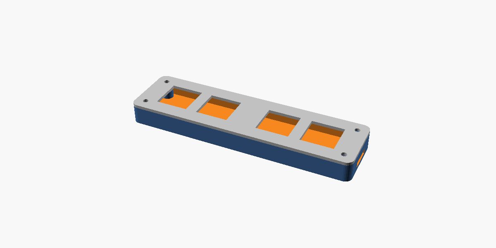

# Glass button bar (page left / page right / genre / random song)

> A no-solder version with a small circuit board and plug-in cable is in [board/](board/README.md).

Four clicky, mashable buttons in a slim bar that sticks to the top of the glass,
in the black-painted border beside the 30" x 11" window. Nothing is cut or drilled.
One flat grey ribbon cable runs from the bar, over the glass edge, to the Pro Micro.



Bar size: about **95 x 26 mm**, about **17 mm tall** with keycaps.

## Parts

Prices are rough guides, not checked against a shop.

| Qty | Part | Notes |
|---|---|---|
| 4 | **Kailh Choc v1** low-profile switches | "White" = clicky, "Brown" = tactile bump. Usually sold in 10-packs (about $8 to $12). Get **v1**, not v2. |
| 4 | Choc v1 keycaps (MBK or CFX profile) | Must say "Choc v1". Blank caps plus a small decal work fine. |
| 1 m | **6-conductor grey ribbon cable, 1.27 mm (0.05") pitch** | About 1 mm thick and 7.6 mm wide. Measure the run from the bar to the Pro Micro and add 20 cm. |
| 1 | 3M VHB tape, clear (4910) | Sticks the bar to the glass; peels off with fishing line if needed. |
| 4 | M2 x 6 mm self-tapping screws | Hold the plate on the tray. |
| | Heat-shrink tubing, thin | For the Pro Micro end. |
| | 3D print: `button_bar_tray.stl` + `button_bar_plate.stl` | PLA or PETG, black. Any local library or online print service can print them. |

## Wiring

Each switch has two pins. One pin of every switch joins the shared ground wire.
The other pin gets its own wire.

| Ribbon wire | Bar end | Pro Micro pin | Key sent | Fruitbox action |
|---|---|---|---|---|
| 1 (red stripe) | one pin of **all four** switches | GND | | |
| 2 | ◀ other pin | 15 | Left arrow | Page left |
| 3 | ▶ other pin | A1 | Right arrow | Page right |
| 4 | Genre other pin | 7 | Right Alt | Genre (MusicGroup) |
| 5 | Random other pin | A3 | Space | Add one random song to the queue |
| 6 | spare | | | |

No resistors: the Pro Micro's built-in pull-ups handle it, the same as the keypad.

## Build steps

1. Print the tray and plate.
2. Clip the four switches into the plate from the top until they snap.
3. Peel 6 wires of ribbon apart for about 5 cm at one end. Strip about 3 mm of each.
4. Feed the ribbon in through the slot at the right end of the tray.
5. Solder wire 1 across one pin of each switch (a daisy chain). Solder wires 2 to 5 to the other pins as in the table. Fold wire 6 back and tape it.
6. Screw the plate onto the tray with the M2 screws. Fit the keycaps.
7. Clean the glass with rubbing alcohol. Stick the bar down with VHB tape and press hard for 30 seconds.
8. Run the ribbon over the glass edge under the trim. Leave a little slack if the lid lifts.
9. At the Pro Micro, solder wires 1 to 5 to GND, 15, A1, 7 and A3. Cover them with heat-shrink.

Attract mode (pin 8) is left off this bar on purpose: it and other service
controls (volume, reboot) are planned for a separate, less reachable bar.
Pin A2 is the keypad's "Fill queue" input (up to 20 random songs per press).

## Keypad sketch change

Genre (7) is already in `arduino/seeburg_keypad/seeburg_keypad.ino`.
Page left, page right and random song need three lines added to the `DIRECT[]` table:

```cpp
  {15, KEY_LEFT_ARROW,  DEBOUNCE_MS,      "Page left (Left arrow)" },
  {A1, KEY_RIGHT_ARROW, DEBOUNCE_MS,      "Page right (Right arrow)" },
  {A3, ' ',             DEBOUNCE_MS,      "Random song (Space)" },
```

Fruitbox already turns the page on the Left and Right arrow keys and adds a random song on Space, so no Fruitbox changes are needed.

## Changing the design

`button_bar.scad` is editable in OpenSCAD (free). The settings at the top control
key spacing, the gap between the arrow pair and the other two buttons, bar depth
and ribbon slot size. Render (F6), then File > Export > STL, once with
`part = "tray"` and once with `part = "plate"`.

## Not yet checked

- Not printed or built. The Choc cutout (13.8 mm) and 1.3 mm plate follow the Kailh
  Choc v1 spec. Print the plate first and test one switch before printing the tray.
- Glass thickness and the trim gap for the ribbon are unmeasured.
