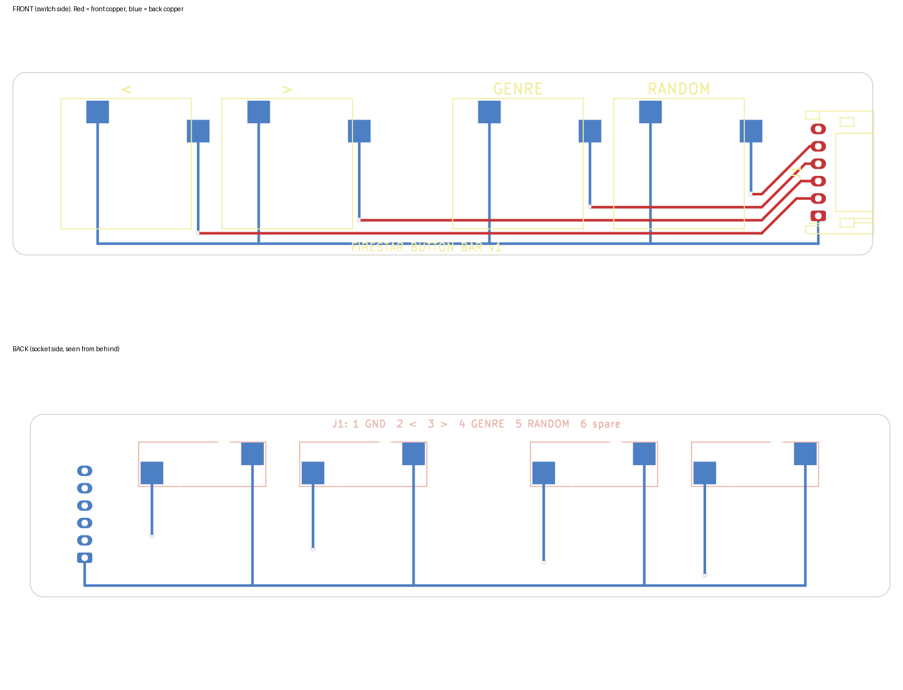
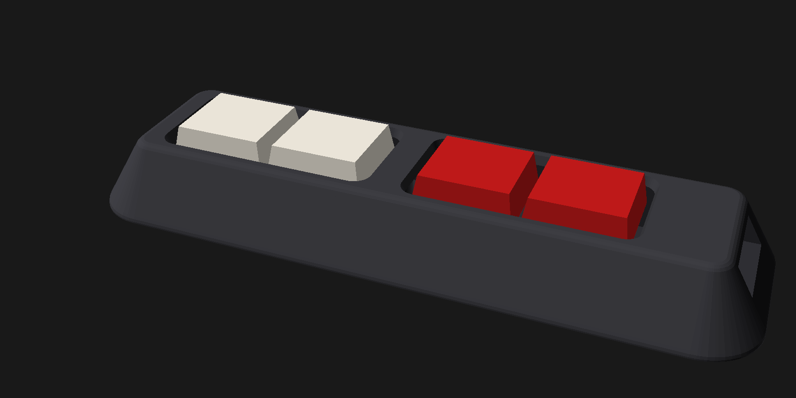

# Glass button bar, no-solder board version

Same four buttons as the ribbon version one folder up (page left, page right,
genre, random song), but the switches push into sockets on a small circuit board and
the cable plugs in. If the board is ordered **with assembly**, the factory solders
the sockets and the plug, and you do no soldering at all.

- Board: 98.75 x 21 mm.
- Case: a low, sloped shape with rounded top edges and two sunken keycap wells,
  so it looks like part of the trim rather than a box. About 116 x 38 mm
  (4½" x 1½") where it meets the glass, 104 x 26 mm across the top, and 13 mm
  (½") tall. Keycaps stand about 2 mm above the top. No screw heads show: the
  screws go in from underneath.
- The plug points out of the right-hand end of the bar.

## Files

| File | What it is |
|---|---|
| `button_bar_gerbers.zip` | Upload this to the board maker (JLCPCB, PCBWay, etc.). |
| `jlc_bom.csv`, `jlc_cpl.csv` | Parts list and parts positions for JLCPCB's assembly option. |
| `button_bar_case_tray.stl`, `button_bar_case_lid.stl` | 3D-print files for the case. |
| `button_bar_pcb_case.scad` | Editable case (OpenSCAD, free). |
| `button_bar.kicad_pcb`, `make_pcb.py` | Board design (KiCad 7). `make_pcb.py` rebuilds it. |

## Ordering the board (JLCPCB)

1. Go to jlcpcb.com, click **Order now**, and upload `button_bar_gerbers.zip`.
   Leave the defaults (2 layers, 1.6 mm). Pick a black solder mask if you like.
2. Turn on **PCB Assembly**. Choose **assemble bottom side** for the sockets, and
   also the top side (through-hole) for the plug. Quantity 2 is enough.
3. Upload `jlc_bom.csv` and `jlc_cpl.csv` when asked. The sockets are LCSC part
   **C5333465** (Kailh CPG135001S30). The plug is **JST S6B-PH-K-S**; if their
   search does not match it, type that name into the part search.
4. On the placement preview, check each socket's two square pads line up with
   the socket drawing. Rotate it there if not.

If you'd rather save money and solder 14 easy joints yourself, skip assembly and buy
the sockets and plug separately (search "Kailh Choc hotswap socket" and
"JST PH 6 pin right angle").

## Other parts

| Qty | Part | Notes |
|---|---|---|
| 4 | Kailh Choc **v1** switches | White = clicky, Brown = tactile bump. |
| 4 | Choc v1 keycaps | Blank caps plus a small decal work fine. |
| 1 | **JST PH 2.0 mm, 6-pin to Dupont female** cable | The Dupont end pushes onto Pro Micro header pins. Measure the run from the bar to the Pro Micro; if it is longer than the cables on sale, add a JST PH 6-pin extension. |
| 4 | M2 x 10 mm **countersunk (flat-head)** self-tapping screws | Go in from underneath, through the tray and board, into the lid. |
| 1 | 3M VHB tape, clear (4910) | Sticks the bar to the glass. |

## Wiring (cable plug to Pro Micro)

| Plug pin | Signal | Pro Micro pin | Fruitbox action |
|---|---|---|---|
| 1 | Ground | GND | |
| 2 | ◀ | 15 | Page left (Left arrow) |
| 3 | ▶ | A1 | Page right (Right arrow) |
| 4 | Genre | 7 | Genre (Right Alt) |
| 5 | Random song | A3 | Adds one random song to the queue (Space) |
| 6 | spare | | |

Pin 1 is marked with a square pad on the board and on the back silkscreen.
Cable colours vary by seller, so follow the pin numbers, not the colours.

## Assembly

1. Print the tray (bottom down) and lid (the STL is already flipped, top down).
   Black PETG or matte black PLA. 0.2 mm layers are fine.
2. Lay the board in the tray, sockets facing down, plug toward the open end.
3. Push the four switches into the board from the top until they seat.
4. Put the lid on. Turn the bar over and drive the four M2 screws in from
   underneath until the heads sit flush. Don't over-tighten: they cut their own
   thread in the plastic.
5. Push the keycaps on. Plug the cable in through the tunnel in the end.
6. Clean the glass with rubbing alcohol, stick the bar down with VHB tape, press
   hard for 30 seconds.

## Not yet checked

- Nothing has been made yet. The socket and switch hole positions follow the
  widely used open-source Choc v1 hot-swap footprint, and the board passes KiCad's
  design check, but check the JLCPCB placement preview before paying.
- Choc heights are from memory: print the lid first and test one switch and cap in
  a well. If the cap rubs or sits too low, change `lid_above` in the .scad file.
- Bar position, depth and cable route wait on the border width and whether the
  glass lid lifts.
