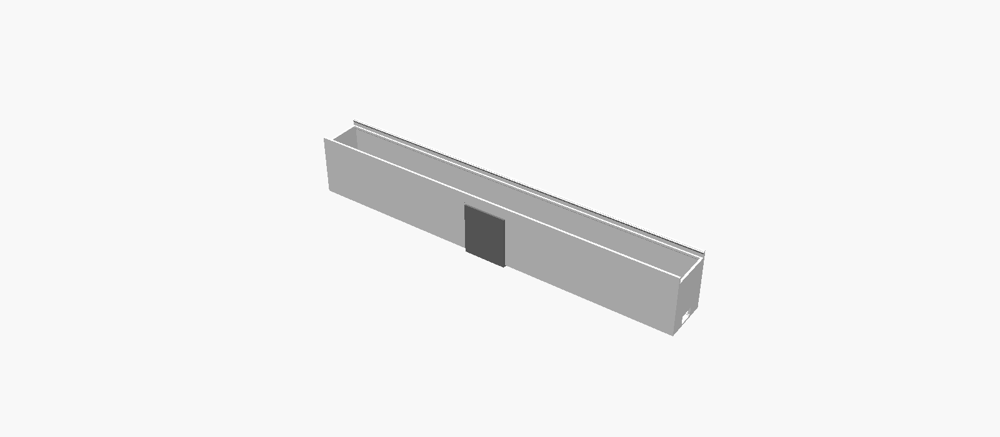

# Glass light box (LED backlight for the coloured glass)

A printed trough, 14" long, that clips onto the **back** of the original Seeburg
title-strip panel, one behind the coloured glass above the selection numbers and
one behind the glass below. A 5 V LED strip is taped to the floor of the box. The
light has about 2" to spread before it reaches the glass, so it glows evenly
like the old tube lighting instead of showing a row of dots.

| File | Size | What it is |
|---|---|---|
| `glass_light_box_fittest.stl` | 40 x 42.5 x 20 mm | short piece to check the clip fit (print first) |
| `glass_light_box_half1.stl` | 178 x 42.5 x 57 mm | first half, wire slot in its outer end |
| `glass_light_box_half2.stl` | 178 x 42.5 x 57 mm | second half, wire slot in its outer end |
| `glass_light_box_sleeve.stl` | 40 x 46 x 48 mm | slides over the joint between the halves |

For two boxes (above and below the numbers): 2 x half1, 2 x half2, 2 x sleeve.

## How it fits

- The open side faces the glass. The box's two long walls run 6 mm past a small
  ledge (the "skirt") and slide over the **outside** of the panel's side-channel
  walls, with a grip ridge at each tip. The channel walls stop on the ledge.
- The skirt is open at the ends, so it passes over the panel's own end walls.
- The inside is 38.5 mm wide at the skirt (1.5" channel + 0.4 mm fit).
- The floor has a 12.5 mm wide, 0.6 mm deep guide for the strip, so it runs
  straight down the middle. Tape it in before clipping the box on.
- A 14 x 8 mm slot at the floor of each outer end lets the wires out. Tape over
  the one you don't use.

## Printing

- **Floor down**, open side up. No supports.
- White or natural PLA/PETG (white reflects the most light). 0.2 mm layers, 3 walls.
- Glue the two halves end to end (open ends together), then slide the sleeve over
  the joint from below.

## Step 1: fit test

Print `glass_light_box_fittest.stl` and push it onto the back of the panel over one
side channel. It should go on with a firm push and stay put. Tell me:

- too tight / too loose (change `FIT`),
- whether the ledge sits on the channel walls,
- whether something gets in the way (the black metal clips on the outer wall, or
  the wall between the side channel and the lamp channel).

Settings are at the top of `glass_light_box.scad`: `CH_OUT` (channel width the
skirt hugs), `FIT`, `SKIRT`, `RIDGE`, `DEPTH`, `BOX_L`, `STRIP_W`.
