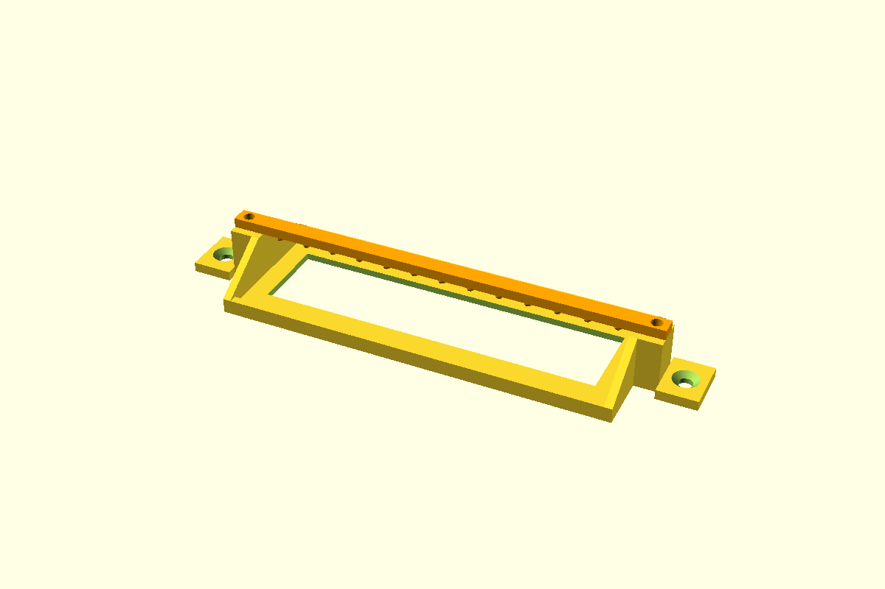

# Keypad splice holder

A 3D-printed tray and strap for the 13 lever splice connectors (Adafruit 5619,
the clear inline 1-in/1-out type) that join the keypad harness wires to the
wires going to the Teensy. The connectors clip together side by side and drop
into the tray. A strap across the middle, between the levers, has a short peg
that goes into the hole on top of each connector, and screws onto the two end
walls. The levers stay free and the wires leave from both long sides.

Status: sized for 13 connectors (2026-10-29: Andrew needs 13; each is 8.68 mm wide,
from his block of 11 at 95.5 mm, so 13 is about 112.8 mm). Measured block of 11 (95.5 mm wide,
39.4 mm along the wires, 14.75 mm tall). The strap is 5.2 mm wide to sit in
the 5.5 mm groove across the connector tops, with round 2.65 mm pegs for the
2.74 mm holes (Andrew's measurements). The groove floor measured 14.8 mm above the
connector bottom; after fit test 2 the screw posts were lowered 1 mm to 13.8 mm, so the strap is a flat
bar lying in the groove. The end walls are full post height only beside the
posts and slope down to lip height at the holder's ends, so the levers are free. Fit test 1 (2026-10-29):
tray width, peg spacing and strap width are right. Not printed yet.

## Files

| File | What it is |
|---|---|
| `splice_holder_fittest.stl` | **Print first.** Tray, only 2 connectors wide. |
| `splice_strap_fittest.stl` | **Print first.** Matching 2-connector strap. |
| `splice_holder_holder.stl` | The real tray for all 13, with two mounting ears for #6 wood screws. |
| `splice_strap.stl` | The real strap for all 13. |
| `splice_holder.scad` | The design (OpenSCAD), if a size needs changing. |

Print flat, no supports. The strap prints with the pegs facing up. PLA or PETG.
Strap screws: two M3 x 10 mm or #4 x 3/8" self-tapping screws into the end walls.

## Fit test

Clip 2 connectors together, put them in the fit-test tray, and screw the
fit-test strap on.

- **Should:** connectors drop in with a little friction, the pegs drop into the
  holes, the strap sits flat on the connector tops, and both levers open fully.
- **Pegs miss the holes:** measure from one wire end to the hole centre, and
  tell me (`hole_y`, `hole_x`).
- **Pegs too tight or too loose:** change `peg_d` (now 2.65 mm for a 2.74 mm hole; was 2.5 until fit test 2).
- **Strap doesn't touch the groove floor, or rocks:** adjust `groove_z` (now 13.8 mm).
- **A low lip on a wire side covers a wire hole:** lower `side_lip_h`.

Fit test 2 (2026-10-29): holder 1 mm lower (posts 15.8 mm) and 2.65 mm pegs fit perfectly. The real holder and strap were then widened to 13 connectors.
