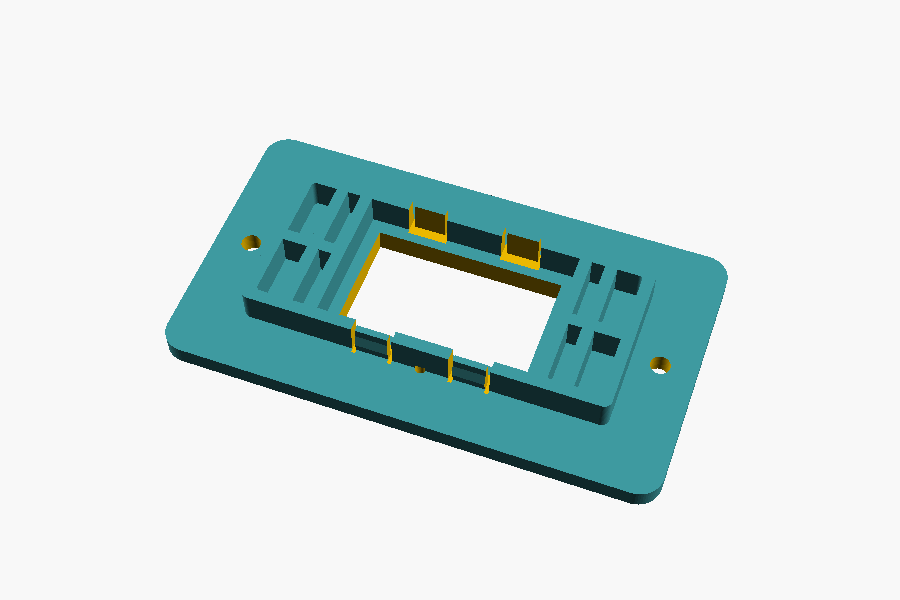

# Power inlet cover plate

A solid plate that covers the old 91 x 41 mm plug hole in the cabinet and
holds the new IEC C14 inlet (fuse + red rocker switch).

- The cabinet hole stands upright in 2 mm steel, with an old screw hole
  6.7 mm out from the middle of each side.
- Plate: 122 mm tall x 69 mm wide, 6 mm thick, chamfered front edge.
- On the back a ribbed lip (8 mm deep, 0.1 mm smaller than the hole all
  round) pushes into the hole so the plate can't slide or twist.
- 4 springy clips on the lip (2 each long side) click behind the 2 mm
  metal panel and hold the plate flat.
- 2 holes (4.8 mm) line up with the old TOP and BOTTOM screw holes for the
  old #8 hex-head sheet-metal screws (the ones a 1/4" driver turns). The
  side holes end up hidden behind the plate.
- The inlet is centred.
- Seeburg logo engraved 0.8 mm into the front, above the inlet (`LOGO = "full"`),
  or just the S swoosh top left (`LOGO = "s"`). Mount it logo end up.
- Inlet cutout 47.3 x 27.8 mm, full 6 mm thick all round (the inlet has no
  snap clips).
- 2 holes for the inlet's screw ears (40 mm apart), 2.6 mm pilot for
  M3 x 8 mm self-tapping screws. These screws are what hold the inlet.

## Files

| File | What |
|---|---|
| `power_inlet_hole_test.stl` | Thin frame with the lip, the 4 clips and the 2 screw holes. Push it into the cabinet hole until the clips click, then check the 2 holes line up with the old top and bottom holes. |
| `power_inlet_inlet_test.stl` | Small piece with just the inlet cutout and ear holes. Push the inlet in from the front: it should slide in snugly and the ear holes should line up. |
| `power_inlet_plate.stl` | The real plate, full Seeburg logo. Print after both tests pass. |
| `power_inlet_plate_s.stl` | Same plate with just the S swoosh, top left. |
| `power_inlet_plate.scad` | Source (OpenSCAD). Needs `seeburg_logo.svg` and `seeburg_s.svg` beside it. |

## Printing (Bambu P1S)

- Front face down on the bed (the lip points up). No supports.
- PETG or ASA if you have it (PLA is OK, it just softens in heat).
- 5 walls, 40 % gyroid infill, 0.2 mm layers.

## Numbers to check

The inlet sizes come from the seller's listing. Measure the real part:

- the body that goes through the panel (listing 47 x 27.5 mm) -> `CUT_W`, `CUT_H`
- centre to centre of the two ear screw holes (guessed 40 mm) -> `EAR_PITCH`
- the old hole if it isn't exactly 91 x 41 -> `HOLE_W`, `HOLE_H`
- screw hole centre to hole edge (Andrew measured 6.7 mm) -> `SCREW_OUT`

## Safety

This carries mains voltage. The inlet's earth pin (the middle one, green/yellow
wire) must go to earth: the power supply's earth terminal and any metal
chassis. Fit the right fuse, and leave the plug pulled while you wire it.
