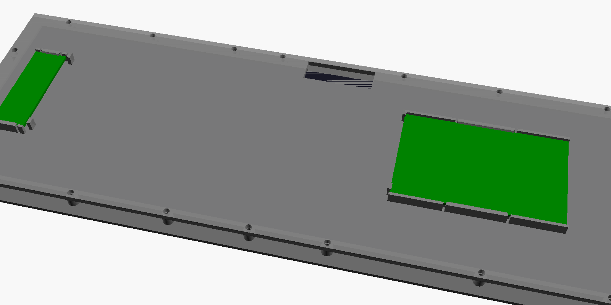

# Frame for the screen 2 status monitor

Holds the 14.5" 2560x720 bar panel (364 × 113 mm) and its two boards behind
the clear glass in the right panel beside the keypad (glass opening
14.75 × 4.74" = 374.6 × 120.4 mm).

The frame is about 391 mm long, too long for the P1S bed, so it prints as four
pieces. All of them print flat with no supports; use black PLA for the front,
since the face shows through the glass.

| File | What it is |
|---|---|
| `status_monitor_front_left.stl`, `status_monitor_front_right.stl` | Black face with the screen window, the pocket the panel drops into, and screw posts. Print face down. |
| `status_monitor_back_left.stl`, `status_monitor_back_right.stl` | Cover that holds the panel in. The boards snap onto its outside,. Print flat, trays up. |
| `status_monitor_back_left_feet.stl`, `status_monitor_back_right_feet.stl` | The same back pieces with ten 16 mm feet, so the frame can lie face up on a table without resting on the boards (about 11 mm clear above the boards). Print these or the plain back pieces, not both. Leave room behind the frame in the cabinet for them. |
| `status_monitor_tray_test.stl` | Just the two board trays. Print this first and check both boards snap in. |
| `status_monitor_tray_test_main.stl`, `status_monitor_tray_test_small.stl` | The same two trays as separate pieces, to print one at a time. |
| `status_monitor_corner_test.stl` | One corner of the front (60 × 45 mm). Lay the panel in it screen down: it should sit level with the top of the wall (thickness), and the face should cover the panel's black border but none of the picture. |
| `status_monitor_joint_test.stl` | 15 mm either side of the front join, plus three copies of the back join marked 0, .05 and .1 (clearance in mm). The joints are a press fit: find the tightest one that still pushes in. The big parts use 0; if that's too tight, set `dove_gap` to the one that worked and export again. |
| `status_monitor_section_test.stl` | A 20 mm slice across the whole height of the front. Put it on the glass and slide both into the cabinet's glass channel to check the face's thickness and how far its edges reach. It has a screw post at the top and bottom. |
| `status_monitor_section_test_plus0.5mm.stl`, `status_monitor_section_test_plus1mm.stl` | The same slice with the face 0.5 mm or 1 mm taller on each edge (137.4 and 138.4 mm tall), to find the snuggest fit in the channel. The 0.5 mm one fit best, so the frame now uses it (`flange_v` = 8.5). |
| `status_monitor_section_test_back.stl` | The matching 20 mm strip of back cover. Screw it onto the slice with two M3 self-tapping screws to check the screw heads clear the metal too. |
| `status_monitor_notch_test.stl` | The middle of the top edge (80 mm). Hold it against the panel's top edge: the panel's ribbon should come out through the notch. |

## Putting it together

1. Lay the two front halves face down and press the dovetails at the top and
   bottom together (a little glue helps).
2. Stick thin foam tape (about 1 mm) on the back of the panel and drop it into
   the pocket, screen down. Its ribbon goes through the notch in the top wall.
3. Feed the ribbon through the slot in the back cover and screw the two back
   pieces on with M3 × 6 mm pan-head self-tapping screws (18 of them; no longer
   than 6–8 mm or they come out through the front). The back is split
   in a different place from the front, so it also locks the two front halves
   together. The two back pieces press together with three dovetails.
5. Lay the glass on the face and slide both into the cabinet's glass channel
   together. Only the thin face goes into the channel; the posts, walls and back
   cover stay within 4.5 mm of the walls so they clear the bevelled metal (about
   5 mm of room).
4. Snap the driver board (HDMI / USB-C end toward the outside end)
   and the small button board into their trays, and plug the ribbons in.

## Measure before printing

These numbers come from the seller's photos. Check them and change them at the
top of `status_monitor_frame.scad` if they're different:

- `panel_t`: the panel's thickness (set to 4 mm).
- `fpc_x`: where the panel's ribbon leaves its top edge, measured from the
  panel's centre (set to 8 mm right of centre, seen from the front).
- `main_l`/`main_w` and `key_l`/`key_w`: the two boards (88 × 55 and 19 × 55.5 mm, set from the tray tests; PETG flexes less than PLA if the rails bow).
- `flange` / `flange_v`: how far the face reaches past the glass opening at the ends (8 mm) and at the top and bottom (8.5 mm, from the channel test).

In OpenSCAD, change a number, set `part` to each piece in turn, press F6 and
export the STL.

Not test-printed yet.
