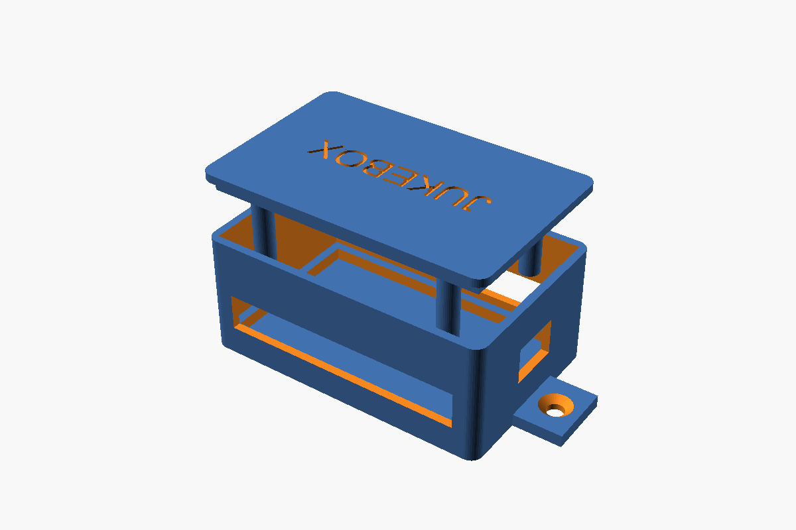

# Case for the Teensy board

A two-part 3D-printed box for the Teensy 4.1 plugged into the Treedix
screw-terminal breakout board (66 × 40.6 mm).

- **Base** (`teensy_case_base.stl`): the board sits on a ledge inside. Long slots
  on both sides let the wires reach the screw terminals, there's an opening at one
  end for the USB cable, and two ears screw it to the cabinet (#6 wood screws).
- **Lid** (`teensy_case_lid.stl`): pushes on. Four posts hold the board down.
  "JUKEBOX" is engraved on top.

Print both flat side down; no supports needed. PLA is fine inside the cabinet.

**Before printing, measure your board** and check the numbers at the top of
`teensy_case.scad`: `board_l`, `board_w` and `stack_h` (height from the board's top
to the top of the Teensy). Put the Teensy's USB end at the end with the opening.
Change a number in OpenSCAD, press F6, and export each part as STL
(`part = "base"`, then `part = "lid"`).

Not test-printed yet.
