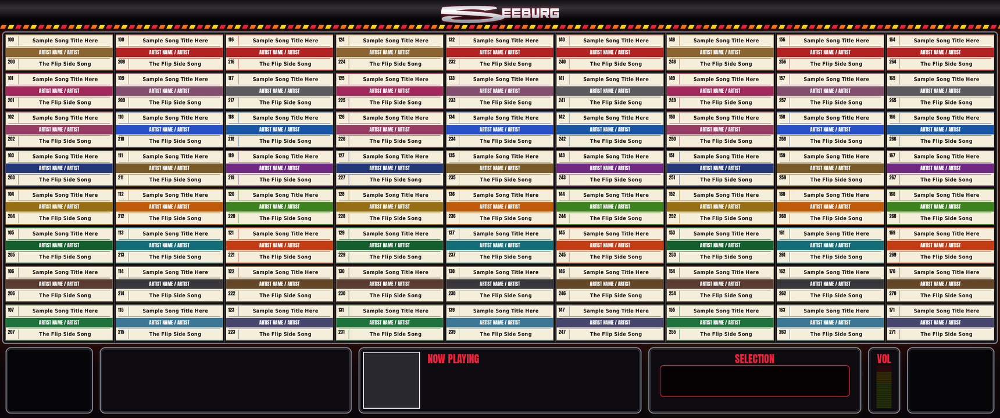

# Firestar ultrawide skin (Fruitbox v3)

A 3440x1440 skin for the 34" 21:9 screen under the Firestar's glass. It mimics the
Seeburg program holder: **72 title strips (9 columns x 8 rows) = 144 selections, A side
on top, artist band in the middle, B side below**, numbered like the real Seeburg: each
strip is one record with its **A side = 1xx on top and B side = 2xx below** (100/200,
110/210, ...), printed on each strip to match the number-only keypad. The **tens digit
is the row (0-7) and the ones digit is the column (0-8)**: column 1 = 100/200 down to
170/270, column 2 = 101/201 down to 171/271, ... column 9 = 108/208 down to 178/278.
No code ends in 9 (checked 178/278 on the Pi, 2026-11-09). (`SelectButtonsSequence = colrow` in fruitbox.cfg does the pairing.)



**Fills the whole screen.** The glass was repainted (2026-11-08): the paint border is now
1.25" at the left and right of the 37" x 15" glass and 0.75" at the top and bottom, a window of
about 34.5" x 13.5". That is bigger than the 34" panel's ~31.3" x 13.1" picture, so the whole
picture shows and the skin uses all of it, with 0.15" (16 px) spare at each edge. Strips are about
3.4" x 1.1" on the glass (369 x 125 px). If the paint ever covers part of the picture, put how
much it hides on each edge in `MASK_IN` at the top of `build_skin.py` and rebuild.

Full-resolution close-up of the strips: `preview_detail.png`.

`preview.png` is a layout mock-up of the full-screen version: the skin's own background and
strip pictures with sample text drawn on. (`preview_detail.png` is an older real Fruitbox render
of the smaller 30" x 11" layout.)

## What's on screen

- **Header:** the Seeburg logo in the middle of the chrome bar (baked into `background.png` from `seeburg_logo.png`), a row of glowing red/orange/yellow bars under it like the Firestar's selector panel (they twinkle: the bars stay put and each one briefly flares brighter at its own random moment; 60 frames in `lightbars/`, a 3 second loop. Set `LIGHT_BAR_ANIM = False` in `build_skin.py` for still bars, or change `LIGHT_BAR_TICKS` for the speed), FREE PLAY / CREDITS n (left), current genre group from the genre button (right; also shows the attract-mode genre when attract mode is on). Fruitbox has no per-genre song count, so the count comes from the group name that `genre_library.py` writes (e.g. `Country (412)`).
- **Sounds:** a click on button presses and a mechanism sound on page turns, both copied from Fruitbox's Classic skin (`JBBPress.wav`, `JBPTurn.wav`). Like Classic, they stay silent while a song is playing, and every sound (including the record drop) stays silent while Fruitbox is muted (Left Ctrl, the volume knob press). When each song loads, the record-drop sound from Fruitbox's Carousel skin (`recpop.wav`) plays, as in Carousel. The page turn is slowed to match the ~2 second sound: `TURN_SPEED` (5, set on the Pi; lower = slower) and `TURN_RIPPLE` (delay from first to last column, in frames) in `build_skin.py`.
- **Short strip titles:** titles over 25 characters end in "..." on the strips only (Now Playing, Coming Up and the second screen keep the full title). Fruitbox can't do this itself, so `strip_titles.py` writes each genre folder's `fruitbox.db` with the short title in the Custom field, and the skin shows that field. It must run after `genre_library.py` (in `update-jukebox.sh`); without it the strip titles are blank. Turn it off with `SHORT_TITLES = False` in `build_skin.py`.
- **Rack:** strip colour follows the song's genre tag, using the families in the owner's genre list (genres.json from a music library manager): each top genre has its own colour and its sub-genres and alternate names share it (e.g. Classic Rock and Grunge use Rock's orange; Soul and Funk use R&B's purple; Rock & Roll uses Oldies' red). Unlisted tags get Seeburg red. Edit `GENRE_FAMILIES` in `build_skin.py` to change them. Long titles are shortened on the strips (see below).
- **Colours:** taken from the Firestar's selector panel: red, orange and yellow glows on black, with the SELECTION heading on a lime-green label like the "1st DIGIT" box. They are `FS_RED`, `FS_ORANGE`, `FS_YELLOW` and `FS_LIME` near the top of `build_skin.py`.
- **Selection readout:** calculator-style 7-segment digits (`technology.bold.ttf`, from Fruitbox's Carousel skin) in red, over dim unlit "888" segments like a real calculator display. The second screen's selection and play-time readouts use the same font. Colours: `LED_ON` and `LED_GHOST`.
- **Bottom:** a spectrum analyser at each end (left channel on the left, right on the right, 8 rainbow bars each, like the Classic skin), Now Playing with cover art (the cover clears to an empty frame when the song ends, like the title and artist; Fruitbox would otherwise leave the last cover up, so `art_blank.png` is drawn over it), the selection readout, Coming Up (next 4). The bars are live: Fruitbox drives them from the music, so they sit empty when nothing is playing. `footer_spectrum_mockup.png` shows roughly how they look mid-song (a mock-up; the emulated test can't play audio).
- Each column holds two letters: rows 1-4 are the first letter, rows 5-8 the second (column 1 = A then B, column 2 = C then D, ... column 10 = U then V).
- Left/Right turns the page (a horizontal "turn" animation rippling across the columns). Pages also auto-turn every 2 minutes.

## Install on the Pi

Copy the `Firestar Ultrawide` folder to `/home/mtmace` on the Pi, then:

```bash
sudo cp -r "/home/mtmace/Firestar Ultrawide" /opt/fruitbox/skins/
```

The folder name has a space in it, so keep the quotes. If an older copy named just
`Firestar` is still installed, remove it so the chooser doesn't list the skin twice:

```bash
sudo rm -r /opt/fruitbox/skins/Firestar
```

Then set `SKIN="/opt/fruitbox/skins/Firestar Ultrawide/fruitbox.cfg"` in `launch-fruitbox.sh`
(in `Fruitbox/fruitbox-setup`), or pick "Firestar Ultrawide" in the skin chooser.

The skin chooser shows `Firestar Ultrawide/screenshot.jpg` (1920x1080, the same as Fruitbox's
stock skins) as its preview picture. `build_skin.py` leaves it alone. After a layout
change, press the Screenshot button (Right Ctrl) while the skin is running to replace it.

The skin has **no MusicPath** on purpose: `fruitbox.ini` owns the music and the
per-genre groups. A 2560x1080 panel works too (Fruitbox scales the skin; same 21:9 shape).

## Tweaking

Everything is generated by `build_skin.py` (needs Pillow and Fruitbox's stock skins
for the fonts). Edit the constants at the top (grid size, strip size, genre colours,
fonts) and run:

```bash
FRUITBOX_SKINS=/opt/fruitbox/skins python3 build_skin.py   # writes "Firestar Ultrawide/"
```

Handy Fruitbox flags while tuning: `--debug-song-nums` shows each slot's code,
`--no-scale` shows the skin at 1:1.

- **Genre colours** key on the genre *tag* text exactly (e.g. `Rock & Roll`), not the folder group.
- **Attract mode genres:** uncomment the `AttractModeGenre` lines in `fruitbox.cfg` to make the attract button cycle Off, each genre, Any.
- **Second (status) display:** built in. `status_screen.py` (called by `build_skin.py`) adds `SkinSize = 2 1920 1080` and the display-2 objects at the end of `fruitbox.cfg`: cover art, title/artist/album, a 7-segment time readout, Coming Up (next 5), the live selection code, credits and genre. Plug the second screen into the Pi 5's other HDMI port; Fruitbox skips display 2 when only one monitor is connected. Any 16:9 panel works (scaled); for another shape edit `W, H` in `status_screen.py` and rebuild. Preview: `status_preview.png`.
- If the panel ends up mounted upside down, rotate it in the Pi's display settings, not the skin.

## Not yet checked

- Never run on the real Pi or screen. The emulated test can't play audio, so Now Playing was only seen idle (Coming Up was checked with a loaded playlist).
- Fonts (Anton, DejaVu Sans Condensed, Technology) are copied from Fruitbox's own Seeburg, SB-M100 and Carousel skins.
