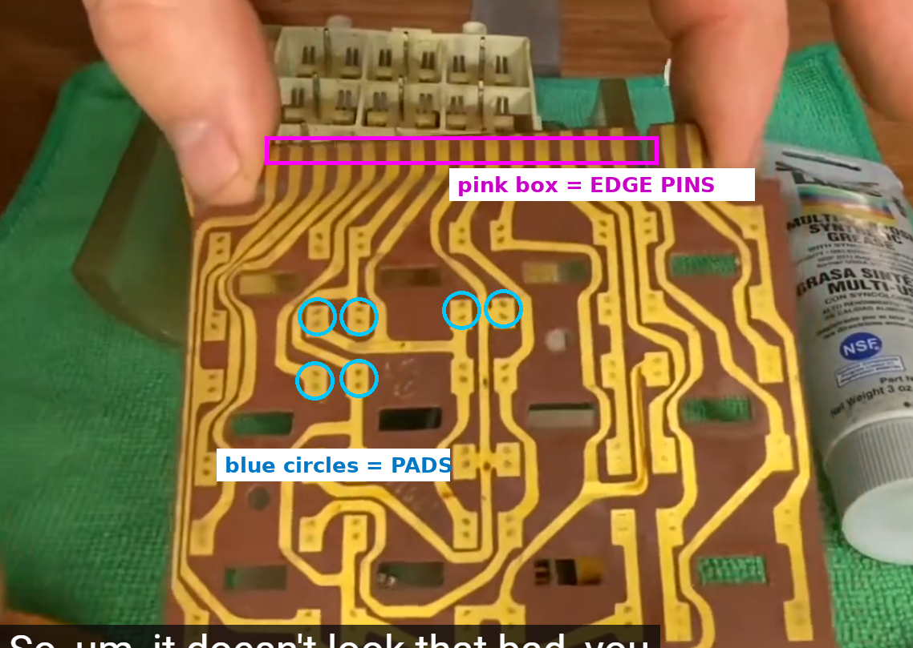

# Seeburg keypad to Fruitbox: beginner guide

This guide connects the original Seeburg keypad to the jukebox so it still looks
stock but types selections into Fruitbox. No previous electronics experience is
assumed. You do this on a table with the keypad **out of the jukebox**. Nothing
here needs mains power: the small boards run off a USB cable.

**How it works in one sentence:** a small board (the **Teensy 4.1**, an
Arduino-compatible board about 6 × 2 cm) plugs into a computer by USB and pretends
to be a keyboard; each of the keypad's wires goes to one of its pins; when you press
a Seeburg key, the Teensy "types" that digit.

There are five stages:

0. Understand the keypad with just your multimeter (optional, no parts to buy)
1. Buy the parts
2. Install the Arduino program and Teensy add-on on your Windows PC
3. Wire the keypad board to the Teensy
4. Run the mapper test to double-check (the pairs from your meter test are already in the program)

---

## 0. First test: understand the keypad with a multimeter

This needs only your multimeter and a paperclip, and takes about 10 minutes. It
shows exactly what a "key press" is, and the numbers you write down help me plan
the rest. You can do it on the original board you already have.

**Words used here**

- **Contact board:** the flat brown board behind the buttons, with gold lines on it.
- **Fingers:** the row of gold or silver strips along one edge of that board,
  where it plugs in.
- **Pads:** the small gold squares, each with two little dots, under each key.
  The metal springs on the back of a button land on these when you press it.
- **Traces:** the thin gold lines. They are just wiring that joins each pad to a
  finger.



*Blue circles are pads, and the pink box is the row of fingers. This photo is
from a video; your board should look very similar.*

**Steps**

1. Take the contact board out of the keypad. **Before you lift it off, mark which
   corner sits under key 1**, because the layout is mirrored once you flip it over.
2. Number the fingers 1, 2, 3 … with a marker, starting at one end.
3. Turn the multimeter's dial to **continuity**: the symbol that looks like a
   sound wave or `)))`. Touch the two probes together and it should beep.
4. Pick one key position. Under it you will see its pads, usually **4, in two
   pairs**: one pair where the left springs land and one where the right springs
   land.
5. Hold one probe on the first pad. Tap the other probe along the fingers until it
   beeps. Write down that finger number. Repeat for the key's other pads.
6. **Pretend to press the key:** lay a paperclip across one pair of pads so it
   touches both. Put the probes on the two fingers you found for that pair. It
   beeps. Lift the paperclip, and the beep stops. **That beep is a key press.** The
   Teensy does the same check, just very fast and for every key.
7. Do the same for one or two more keys.

**Write it down like this, and send it to me in the project thread:**

```
Key 1: left pair = fingers 3 + 11, right pair = fingers 7 + 14
Key 2: left pair = fingers __ + __, right pair = fingers __ + __
```

If a pad doesn't beep to any finger, write "none". That is useful too.

---

## 1. Shopping list

Exact items are in [`PARTS.md`](../PARTS.md) at the top of the repo. For this
guide you need:

| Qty | Part | Notes |
|---|---|---|
| optional | Victory Glass 63-7234 keypad contact board | Not needed: your original board tested fine. Only if a key gets unreliable. |
| 1 | **Teensy 4.1 with pins** | From pjrc.com, SparkFun, Adafruit or Amazon. Not the 4.0, and not "without pins". |
| 1 | Micro-USB to USB-A cable | Must be a **data** cable, not charge-only. |
| 1 | Treedix screw-terminal breakout board for Teensy 4.1 | The Teensy plugs into it; every pin gets a labelled screw terminal, so no loose jumper wires. |
| 1 | 20-conductor rainbow ribbon cable, 28 AWG, 1 m | For the keypad wires. |
| 1 | Soldering kit | Only if you don't have one. |
| | Heat-shrink tube or electrical tape | For tidying the joints. |

You already have a multimeter, which helps in step 3.

---

## 2. Install the Arduino program and Teensy add-on (Windows)

The **Arduino IDE** is a free Windows program that puts our code onto the Teensy.
Think of it as an installer for the little board. **Teensyduino** is a free add-on
that teaches it about Teensy boards.

1. Go to **arduino.cc/en/software**, download **Arduino IDE 2** for Windows and
   install it like any other program.
2. Add the Teensy boards: open **File → Preferences**. In **Additional boards
   manager URLs**, paste
   `https://www.pjrc.com/teensy/package_teensy_index.json` and click **OK**.
3. Click the **board icon** on the left (Boards Manager), search **Teensy**, and
   click **Install**. Windows may ask to install a driver; say **Yes**.
4. Click the **books icon** (Library Manager), search **Adafruit NeoPixel**, and
   click **Install**.
5. Plug the Teensy into your PC with the USB cable. At the top, choose
   **Teensy 4.1** from the board drop-down.
6. Open **Tools → USB Type** and choose **Serial + Keyboard + Mouse + Joystick**.

If the Teensy doesn't show up, the USB cable is probably charge-only. Try another
cable.

---

## 3. Wiring

### 3a. Number the keypad board's fingers

The replacement board has a row of silver **fingers** along one edge. Lay the board
face up with the fingers on the right, as in the shop photo. With a marker, number
the fingers **1, 2, 3 …** starting from the **top**. Write down how many there are.

### 3b. Solder a wire to each finger

1. Cut a piece of ribbon cable about 30 cm long, with as many wires as there are
   fingers. Peel the wires apart at both ends for about 5 cm.
2. Strip about 3 mm of insulation off each wire at one end.
3. Solder one wire to each finger, in order. Wire 1 (the stripe colour) goes to
   finger 1, and so on. Keep each blob of solder **small**, near the outer end of
   the finger.
4. **Check for shorts:** set the multimeter to continuity (the beep setting). Touch
   neighbouring fingers, 1 and 2, then 2 and 3, and so on. They must **not** beep.
   If two do, reheat the joint and wipe away the extra solder.
5. Tape or hot-glue the cable to the board so a tug doesn't pull on the joints.

### 3c. Connect the wires to the Teensy

1. Push the Teensy into the yellow sockets on the Treedix breakout board, with
   the Teensy's USB socket at the same end as the breakout's USB cut-out. Every
   pin now has a green screw terminal with its number printed beside it.
2. At the far end of the ribbon cable, strip about 5 mm off each wire and twist
   the strands so they don't fray.
3. Loosen a terminal's screw, push the wire in, and tighten until a gentle tug
   doesn't pull it out:

| Keypad finger | Screw terminal (Teensy pin) |
|---|---|
| 1 to 13 | **0 to 12** (finger 1 into 0, finger 2 into 1, …) |
| 14 to 20 | **24 to 30** (finger 14 into 24, …) |

Nothing else connects to the keypad board. It needs no power of its own.

---

## 4. Run the mapper test

1. Download **keypad_mapper.ino** from the project files (or the repo's
   `arduino/keypad_mapper/` folder). Double-click it. If Arduino asks to put it in a
   folder, say **OK**.
2. Check the board is **Teensy 4.1**, then click the **→ (Upload)** button at the
   top. The first time, a small "Teensy Loader" window opens; if it asks, press
   the white button on the Teensy once. Wait for "Done uploading".
3. Open **Tools → Serial Monitor**. At the bottom right of that window, pick
   **115200 baud** from the drop-down.
4. Don't touch the keypad for 2 seconds. Then put the keypad's buttons back on the
   board (or press each little switch directly). Press and **hold** each key, one at
   a time, in this order: **0, 1, 2, … 9, Left RESET, Right RESET**. Release each
   key before pressing the next.
5. Each press prints a line like `KEY DOWN: 3-11 7-14`. The numbers are finger
   numbers.
6. Select all the text in the Serial Monitor (click inside it, then Ctrl+A and
   Ctrl+C) and paste it into the project thread. Also tell me the order you pressed
   the keys in.

Your meter results are already in the program, so this is a double-check: I
compare the log with them and fix any that differ. You then upload
`seeburg_keypad.ino` the same way, plug the Teensy into the Pi, and the keypad
types selections into Fruitbox.

### If something goes wrong

| What you see | What it means |
|---|---|
| Nothing at all in the Serial Monitor | Check the port at the top is the Teensy, and that USB Type is set (step 2.6). |
| A key prints nothing | Check that key's fingers for a loose solder joint. |
| Pairs listed under ALWAYS JOINED | Two fingers are touching. Redo step 3b, point 4. |
